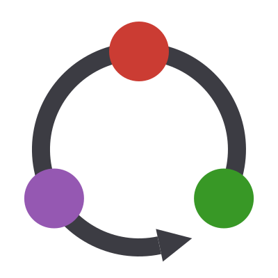

<p align="center">
  <picture>
    <source media="(prefers-color-scheme: dark)" srcset="docs/src/assets/logo-dark.svg">
    
  </picture>
</p>

# QuditClifford.jl

[](https://maltepuetz.github.io/QuditClifford.jl/stable/)
[](https://maltepuetz.github.io/QuditClifford.jl/dev/)
[](https://github.com/maltepuetz/QuditClifford.jl/actions/workflows/CI.yml?query=branch%3Amain)
[](https://codecov.io/gh/maltepuetz/QuditClifford.jl)
[](https://github.com/JuliaTesting/Aqua.jl)
[](https://doi.org/10.5281/zenodo.24170577)

QuditClifford.jl simulates qubit and qudit Clifford circuits with stabilizer
tableaux, for any prime local dimension `d` and for pure and mixed stabilizer
states.

- **Clifford unitaries:** named gates for every prime `d`, general Clifford
  operators with composition and inversion, and uniformly random Cliffords and
  stabilizer states.
- **Measurements and expectation values:** projective Pauli measurements,
  exact expectation values, and dephasing, trace-out and reset channels.
- **Entanglement:** entropy, negativity, and mutual, conditional and
  tripartite information as exact integers in units of `log d`.
- **Inspection:** exact kets, state vectors and density matrices of small
  states, for debugging.

> **Development status:** QuditClifford.jl is under active development and has
> not yet reached a stable release. APIs may change before version 1.0.

## Installation

```julia
using Pkg
Pkg.add("QuditClifford")
```

QuditClifford requires Julia 1.10 or later.

## Quick start

Prepare an entangled pair of qutrits, measure one of them, and watch the
entanglement disappear:

```julia
julia> using QuditClifford

julia> state = DestabilizerTableau(3, 2; state = :product);  # two qutrits in |00⟩

julia> apply!(state, Fourier(1)); apply!(state, SUM(1, 2));  # entangle them

julia> entanglement_entropy(state, [1])  # in units of log 3
1

julia> t = measure!(state, SinglePauli(1, 0, 1));  # Z on qutrit 1: random t ∈ 0:2

julia> measure!(state, SinglePauli(2, 0, 1)) == t  # qutrit 2 now gives the same outcome
true

julia> entanglement_entropy(state, [1])
0
```

[Getting Started](https://maltepuetz.github.io/QuditClifford.jl/dev/getting-started)
walks through states, Pauli operators, gates and measurements step by step;
the [manual](https://maltepuetz.github.io/QuditClifford.jl/dev/manual/) and
the [examples](https://maltepuetz.github.io/QuditClifford.jl/dev/examples/qutrit-measurement)
go further.

## Documentation and support

- [Stable documentation](https://maltepuetz.github.io/QuditClifford.jl/stable/)
- [Development documentation](https://maltepuetz.github.io/QuditClifford.jl/dev/)
- [Issue tracker](https://github.com/maltepuetz/QuditClifford.jl/issues)
- [Changelog](CHANGELOG.md)

When using QuditClifford in research, cite it with the metadata in
[`CITATION.cff`](CITATION.cff) (GitHub's "Cite this repository" button exports
it as BibTeX or APA) and include the package version used. Every release is
archived on Zenodo: [10.5281/zenodo.24170577](https://doi.org/10.5281/zenodo.24170577)
always resolves to the latest version, and each version's record carries its
own DOI for citing the exact release.

QuditClifford is maintained by Malte Pütz and distributed under the
[MIT License](LICENSE).
